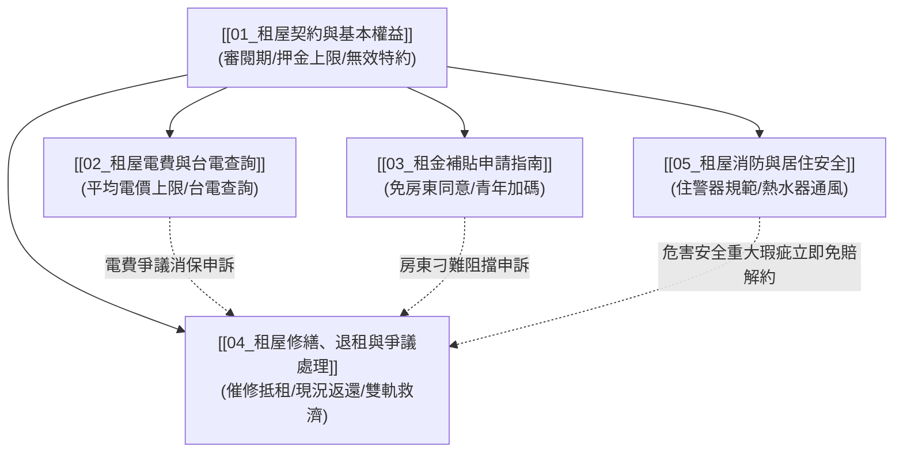

# 🎓 大學生租屋指南 LLM Wiki 知識庫 (Obsidian Vault MOC)

> 歡迎查閱「大學生租屋指南」LLM Wiki！  
> 本知識庫落實 Andrej Karpathy 倡導之 **LLM Wiki 精神**，以中華民國政府官方公開之法律、法規命令、定型化契約公告及權威機構作業規定為唯一主要依據，建構兼具**嚴謹事實依據（Fact-Grounded）**、**可追溯性（Auditable）**與**實用教學轉化（Pedagogical）**之 Obsidian 結構化知識庫。

---

## 🧭 核心主題文章目錄 (Map of Content)

| 編號 | 篇章主題 (Wiki Link) | 知識領域 | 關鍵核心法規與教學主旨 | 原始存證檔案 |
| :---: | :--- | :---: | :--- | :--- |
| **01** | [[01_租屋契約與基本權益]] | 法規契約 | 契約審閱期至少 3 日、押金上限 2 個月、凍漲租金、不得記載事項（禁止轉嫁稅負與禁止限制補貼戶籍） | `raw/01_moi_rental_contract_provisions.txt` |
| **02** | [[02_租屋電費與台電查詢]] | 費用規範 | 113.07.15 電費新制、當期每度平均電價上限公式、公設分攤限制、台電簡易版自立查詢與 60 日延長機制 | `raw/02_taipower_electricity_regulations.txt` |
| **03** | [[03_租金補貼申請指南]] | 政策補貼 | 115 年度受理申請規定、所得 3 倍標準 vs 16 點舊戶帶入 116 之 3.5 倍過渡條款、家庭成員定義、共有房屋 40㎡ 合計換算、單身青年 1.2 倍加碼 | `raw/03_nlma_rent_subsidy_regulations.txt` |
| **04** | [[04_租屋修繕、退租與爭議處理]] | 爭議救濟 | 條例第 8 條出租人修繕義務與催告代修抵扣租金、應記載事項第 14 點任意終止違約金上限嚴格條件、第 18 點法定免賠事由、民法 432 條自然耗損免責、消保與條例 16 條免費調處雙軌救濟 | `raw/04_rental_disputes_and_cpc_procedures.txt` |
| **05** | [[05_租屋消防與居住安全]] | 環境安全 | 住警器設置辦法第 3 至 8 條（位置、距離、偵煙偵熱、電源）、燃氣熱水器安裝標準（屋內 3 類、屋外 1 類、第 6 條已刪除、第 9 條通風限制）、走廊堆物罰則、官方防火診斷與看房安全指引 | `raw/05_fire_safety_alarm_and_water_heater.txt` |

---

## 🔄 跨篇章關聯網絡 (Knowledge Graph)

---

## 📋 原始依據與品質審計報告

- **只讀層原始檔案索引**：請參閱 `raw/README.md`。
- **來源可信度查驗評級**：請參閱 `raw/VERIFY_REPORT.md`（評定 04 為 A 級，01、02、03、05 為 B 級）。
- **Wiki 編修日誌與校正歷程**：請參閱 [[changelog]]（記載本庫之建立歷程、重要法規校正與內容層級標記）。

---

## 💡 使用者查閱與使用指南

1. **標籤分類規範**：
   - **【官方原文】**：逐字轉錄自全國法規資料庫或行政院公報之法律、法規命令原文。
   - **【官方節錄】**：節錄自龐大官方作業要點或公告之核心條款。
   - **【教學整理】**：為大專學生實務操作所需之行動指南、檢核 SOP 與公式示範，絕不混充為法條。
2. **雙括號連結（Obsidian Wikilinks）**：
   - 本 Vault 全面支援 Obsidian 標準雙括號語法（例如 `[[01_租屋契約與基本權益]]`），點擊即可在篇章間無縫跳轉。
